# Documento de diseno y comparacion de herramientas
## Observatorio de Turismo Sostenible — Guatemala (version Power BI)

**Laboratorio 12 · Visualizacion interactiva con Power BI · CC3066 · UVG**
**Fecha:** 8 de noviembre de 2026

> **Estado de este documento.** El informe se abrio y se reviso en Power BI Desktop
> 2.159.1231.0 (64 bits, octubre de 2026) en Windows y se guardo como
> `powerbi/Observatorio.pbix`. Las pruebas, los indicadores y las capturas de Power BI
> se registraron el 8 de noviembre de 2026.

# Parte I. Documento de diseno (ejercicio 4)

## 4.1 Preguntas de gestion, publico y alcance

**Publico.** Direccion de INGUAT, mancomunidades, camaras de turismo y gerencias
de destino, sin formacion estadistica necesaria.

**Preguntas.** Son las 18 del Laboratorio 10, sin cambios:

| Bloque | Pagina | Preguntas |
|---|---|---|
| A. ¿Como vamos? | Panorama | 1. Visita y derrama frente al periodo anterior. 2. Que destinos concentran la visita y se acercan a su capacidad. 3. Evolucion de la demanda. 4. Volumen frente a valor. |
| B. ¿De donde viene y en que gasta? | Explorar | 5. Mercados emisores. 6. Calendario de la demanda. 7. Reparto de la derrama. 8. Ocupacion y gasto. 9. Segmento que deja mas gasto. 10. Alojamiento por destino. |
| C. ¿A que costo? | Sostenibilidad | 11. Huella frente a visita. 12. Destinos sobre su capacidad. 13. Perfil de sostenibilidad. 14. Empleo local y certificacion. |
| D. ¿Que esperar y a quien atender? | Pronostico y Promotores | 15. Visita esperada a 12 meses. 16. Confiabilidad de los modelos. 17. Quien recomendara el destino. 18. Palancas para ganar promotores. |

**Decisiones que apoya.** Priorizar destinos para revisar aforos, calendarizar
promocion y personal, orientar la promocion por mercado y elegir en que aspectos
de la experiencia invertir.

**Fuera de alcance.** No reemplaza estudios de impacto ni de capacidad de carga
(esta entra como parametro), no mide efectos causales, no contiene datos de
empresas individuales y sus pronosticos no incorporan rutas nuevas, crisis ni
campanas. Los datos son **sinteticos y no son cifras oficiales**.

## 4.2 Paleta, fuentes, interfaz y navegacion

Se conserva la paleta del Laboratorio 10; cada color mantiene un solo significado
en todo el informe y se aplica mediante el tema `Observatorio.json`.

| Color | Hex | Significado | Justificacion |
|---|---|---|---|
| Azul | `#4361EE` | Demanda | Color base de lectura; tambien origen de la escala secuencial. |
| Naranja | `#FFA630` | Economia | Calido y separado en tono de la demanda. |
| Verde | `#60A125` | Favorable | Asociacion convencional con buen estado. |
| Rosa | `#F72585` | Presion o alerta | El de mayor llamada de atencion; se reserva para avisos. |
| Morado | `#A2158D` | Estimaciones | Separa lo estimado de lo observado. |
| Violeta | `#4D0A99` | Navegacion | Fuera del grupo de colores de datos. |

El texto usa `#2E3B73` (contraste 8.9:1 sobre blanco) y `#5A6798` (5.1:1). Ninguna
lectura depende solo del color: el estado de presion se escribe como texto
("Holgura", "Al limite", "Saturacion") y las series llevan leyenda.

**Fuentes.** Segoe UI y Segoe UI Semibold, disponibles en Windows, unico sistema
donde corre Power BI Desktop. Sustituyen a la pila SF Pro / Inter del Lab 10.

**Bosquejo (todas las paginas con el mismo esqueleto).**

```
┌─────────────────────────────────────────────────────────────────────┐
│ Observatorio de Turismo Sostenible | Panorama                       │
│ Pregunta general de la pagina                                       │
│ [Panorama][Explorar][Sostenibilidad][Pronostico][Promotores][Guia] [Restablecer]
│ (Periodo ▾) (Region ▾) (Destino ▾)  Viendo: 2022-2025 | Todos       │
│                                     Mensaje si no hay datos         │
├─────────────────────────────────────────────────────────────────────┤
│ tarjetas KPI                                                        │
│ ┌───────────────┐ ┌───────────────┐                                 │
│ │ V1            │ │ V2  ⇅ detalle │  titulo + pregunta en cada      │
│ ├───────────────┤ ├───────────────┤  grafica                        │
│ │ V3 clic filtra│ │ V4            │                                 │
│ └───────────────┘ └───────────────┘                                 │
└─────────────────────────────────────────────────────────────────────┘
```

| Requisito | Implementacion | Principio de HCI / UX |
|---|---|---|
| Navegacion (3.3) | Seis botones de pagina; el activo va relleno en violeta | Visibilidad del estado del sistema |
| Enlace (3.2) | V3 → V1, V2, V4; V5 → V6; V12 → V13, V14; V17b → V18 mediante filtrado o resaltado cruzado | Manipulacion directa |
| Detalle (3.4) | Jerarquia Anio → Trimestre → Mes en V2 y V11; Region → Destino → Categoria en V7 | Control del usuario |
| Filtros (3.5) | Segmentadores sincronizados entre paginas y boton Restablecer | Libertad para deshacer |
| Sin datos | Medida `Mensaje sin datos` con instruccion para salir | Recuperacion de errores |

**Conservado.** Preguntas, datos, modelos, paleta, significado de colores, cinco
secciones y regla de "cada grafica presenta su pregunta".

**Modificado.** La seccion Modelos se divide en Pronostico y Promotores porque la
pagina resultaba larga y sus metricas no son comparables; los popovers se sustituyen
por segmentadores desplegables; desaparece el selector "Resumen / Analisis completo",
y los textos metodologicos quedan en subtitulos y en la Guia.

## 4.3 Justificacion y equivalencia de las visualizaciones

Los segmentadores, tarjetas, botones, textos y tablas comparativas no se cuentan.
Hay 22 graficas y matrices (V1 a V20, V16b y V17b), ademas de la tabla V21 de consulta por visitante.

| Lab 10 | Power BI | Tipo | Justificacion y sustitucion |
|---|---|---|---|
| V1 mapa de burbujas | V1 | Dispersion longitud-latitud | **Sustitucion:** el mapa nativo depende de un servicio externo y de una opcion de seguridad de Desktop; la dispersion conserva la posicion relativa y siempre se dibuja. La presion pasa a V12 y a las descripciones emergentes. |
| V2 serie | V2 | Linea con jerarquia | Tendencia en el tiempo con detalle por nivel. **Cambio:** la comparacion destino/total se hace filtrando con V3. |
| V3 ranking | V3 | Barras horizontales | Comparar 7 categorias de nombre largo. |
| V4 volumen / valor | V4 | Dispersion | Dos variables continuas. **Cambio:** sin lineas de cuadrante. |
| V5 mercados | V5 | Barras horizontales | Ranking; la participacion aparece en la descripcion emergente. |
| V6 calendario | V6 | Matriz con escala de color | Patron mes-anio. **Cambio:** se omite el indice 100. |
| V7 treemap | V7 | Treemap jerarquico | Composicion anidada con detalle. |
| V8 ocupacion / gasto | V8 | Dispersion con tendencia | Relacion entre dos variables continuas. |
| V9 caja | V9 | Columnas P25, mediana y P75 | **Sustitucion:** no hay diagrama de caja nativo y se evita instalar visuales externos. Conserva mediana y rango central; pierde valores extremos. |
| V10 alojamiento | V10 | Barras apiladas al 100% | Compara composicion entre destinos de distinto tamano. |
| V11 doble eje | V11 | Combinado columnas y linea | Comparar ritmos. **Cambio:** indicador fijo en CO2 en lugar de selector. |
| V12 semaforo | V12 | Columnas con linea de referencia | Posicion frente al umbral 1.0. El estado textual va en la descripcion emergente. |
| V13 radar | V13 | Matriz con escala de color | **Sustitucion:** sin radar nativo; la matriz permite comparar los 7 destinos, no solo 3. |
| V14 beneficio local | V14 | Dispersion con tamano | Tres variables. **Cambio:** sin lineas de cuadrante. |
| V15 pronostico | V15 | Linea con limites | Continuidad entre observado y estimado; un modelo a la vez. |
| V16 prueba | V16 y V16b | Lineas y barras de MAPE | Donde se equivoca cada modelo y cuanto en total. |
| V17 matrices | V17 y V17b | Matriz y columnas | Los dos tipos de error y metricas por modelo. |
| V18 ROC | V18 | Linea | Comparacion independiente del umbral. |
| V19 aprendizaje | V19 | Linea | Valor de ampliar la encuesta. |
| V20 factores | V20 | Barras | Direccion y magnitud por modelo, uno a la vez. |
| (tabla no visual) | V21 | Tabla | Consulta individual de predicciones (complementaria). |

## 4.4 Importacion, preparacion, relaciones y calculos

**Power Query.** Cada consulta lee un CSV desde el parametro `RutaDatos`:

1. `Csv.Document` con UTF-8 y coma como separador.
2. `Table.PromoteHeaders`.
3. `Table.TransformColumnTypes` con cultura `en-US`, para que un Windows en espanol
   no interprete mal el punto decimal.
4. En hechos, `Table.RemoveColumns` quita atributos que ya viven en las dimensiones.
5. `Destinos` y `Mercados`: `Table.Distinct` sobre la clave.
6. `GastoCategoria`: `Table.UnpivotOtherColumns` de las cinco columnas de gasto.
7. `Calendario`: un mes por fila, de 2017-01 a 2026-12.

**Relaciones** (17, todas muchos a uno y filtro en una direccion): `Mensual`,
`LlegadasMercado`, `Visitantes` y `GastoCategoria` hacia `Calendario` y `Destinos`;
`LlegadasMercado` hacia `Mercados`; `PredClase[id_visitante]` hacia `Visitantes`; las
tablas de clasificacion hacia `ModeloClase`, y las de pronostico hacia `ModeloSerie`.

**Medidas DAX principales** (49 en total, en `Medidas.tmdl`):

| Medida | Definicion | Finalidad |
|---|---|---|
| Visitantes | `SUM(Mensual[llegadas])` | Volumen; se suma |
| Derrama USD | `SUM(Mensual[gasto_total_usd])` | Volumen economico |
| Visitantes periodo anterior | `CALCULATE` sobre los n anios previos | Misma comparacion que el Lab 10 |
| Estancia promedio | `SUMX(estancia * llegadas) / Visitantes` | Ponderada, como la tarjeta del Lab 10 |
| Presion turistica | `AVERAGE(presion_turistica)` | Media simple, como V1 y V12 |
| Estado y Color de presion | Umbrales 0.85 y 1.0 | Mismo semaforo |
| Gasto P25 / mediano / P75 | `PERCENTILE.INC` y `MEDIAN` | Sustituyen la caja de V9 |
| Estimado futuro, limites, Observado prueba | `AVERAGE` con filtros de alcance, modelo y conjunto | Una sola fila por combinacion |
| MAPE, RMSE, Error absoluto medio | Lectura de `MetricasSerie` | No se recalculan |
| Casos evaluados | `COUNTROWS(PredClase)` | Matriz de confusion |
| Seleccion activa, Mensaje sin datos | Texto | Estado visible y aviso |

**Dato observado.** La suma de `mercados.csv` difiere de `turismo_mensual.csv` por
redondeo del generador: como maximo 3 visitantes por destino y mes, y 20 en total
sobre 29 684 086. El codebook del Lab 10 dice que coinciden; no se corrigio para
conservar los datos, y por eso V5 y V6 pueden diferir en esas unidades de V3.

## 4.5 Incorporacion de predicciones y evaluacion

El Lab 10 recalculaba los modelos al abrir la aplicacion y no guardaba predicciones.
`scripts/exportar_modelos.py` importa su `modelos.py` y exporta los resultados **sin
crear modelos nuevos**, ejecutado con el entorno bloqueado del propio Lab 10
(scikit-learn 1.9.0, statsmodels 0.14.6) porque con otras versiones el MAPE de SARIMA
cambia. Las predicciones por visitante, que el Lab 10 no exponia, se reconstruyen con
la misma definicion, division 75/25 y semilla 42; el script **se detiene** si la matriz
de confusion no coincide con la de `clasificar()`, y coincidio en los tres modelos.

| Tipo | Modelos | Conjunto de evaluacion | Metricas | Tablas |
|---|---|---|---|---|
| Pronostico | Tendencia + estacionalidad, Holt-Winters, SARIMA | Ultimos 12 meses (2025); entrenamiento desde 2022 | MAE, RMSE, MAPE | `PredSerie`, `MetricasSerie` |
| Clasificacion | Regresion logistica, Arbol de decision, K vecinos | 25% estratificado de la encuesta (2 250) | Exactitud, Precision, Exhaustividad, F1, AUC | `PredClase`, `MetricasClase`, `CurvaROC`, `Importancia`, `CurvaAprendizaje` |

Ambas familias estan en paginas separadas y nunca comparten eje.

**Como se evito duplicar o alterar.**

- `scripts/verificar_indicadores.py` confirma: `id_visitante` unico; visitante + modelo
  unico; toda prediccion con visitante; 2 250 filas por modelo y los mismos visitantes;
  llave unica en `PredSerie`.
- `PredClase` se relaciona muchos a uno con `Visitantes`: filtrar nunca multiplica filas.
- Las graficas de clasificacion siempre desagregan por modelo.
- Las metricas se importan, no se recalculan; no dependen del destino, y la pagina lo avisa.
- `PredSerie` no se relaciona con `Calendario`, para que el periodo no recorte 2026.
- `Alcance` no tiene relaciones: las medidas leen una sola seleccion y por defecto usan
  "Todos los destinos", asi nunca promedian series distintas.

**Limitaciones declaradas.** Regresion, arbol y k-vecinos tienen AUC entre 0.66 y 0.71,
capacidad moderada, y generan muchas falsas alarmas (de 519 a 588 de 2 250). SARIMA
emite avisos de convergencia en algunas series por destino.

## 4.6 Planificacion y tiempo de trabajo

**Integrantes:** Pedro Avila, Javier Lopez y Brandon Rivera.

| # | Tarea | Responsable | Terminacion |
|---|---|---|---|
| 1 | Preguntas, alcance y paleta | Todo el equipo | 5 nov 2026 (avance) |
| 2 | Exportacion de datos y resultados | Pedro Avila | 8 nov 2026 |
| 3 | Modelo semantico y reporte PBIP | Pedro Avila | 8 nov 2026 |
| 4 | Revision en Desktop y guardado como .pbix | Javier Lopez | 8 nov 2026 |
| 5 | Pruebas 5.3-5.5 y capturas | Brandon Rivera (Streamlit) y Javier Lopez (Power BI) | 8 nov 2026 |
| 6 | Documento final | Pedro Avila (base) y Javier Lopez (cierre) | 8 nov 2026 |

El equipo no llevo un registro de horas mientras trabajaba. El tiempo de Power BI es una estimacion aproximada del propio equipo, hecha al cierre, no una medicion.

| Herramienta | Tiempo efectivo |
|---|---|
| Streamlit (Lab 10) | No se registro durante el desarrollo |
| Power BI (Lab 12) | Aproximadamente 2 h por integrante, unas 6 h en total (estimacion del equipo). Incluye la sesion en Desktop del 8 nov 2026, de 22:45 a 23:01 |

# Parte II. Comparacion de herramientas (ejercicio 5)

## 5.1 Matriz comparativa

| Criterio | Evidencia en Streamlit (Lab 10) | Evidencia en Power BI | Implicacion |
|---|---|---|---|
| Facilidad de aprendizaje | Exige Python; el equipo ya lo dominaba | Interfaz de arrastrar, mas Power Query y DAX. Desktop se instalo en la PC de Javier el dia de la entrega; el modelo y el reporte se escribieron como PBIP en texto, no en la interfaz | Depende del perfil del equipo |
| Tiempo de desarrollo | 1 180 lineas de nucleo mas 5 vistas; horas no registradas | Modelo y reporte generados por script (`generar_pbip.py`, 591 lineas); unas 2 h por integrante (estimacion) | Sin registro de Streamlit no se puede comparar en horas; ver 4.6 |
| Preparacion y actualizacion | Pandas en `datos.py`; basta reemplazar CSV | Power Query documentado; cambiar `RutaDatos` y Actualizar | Ambos reproducibles |
| Integracion de modelos | Directa: los modelos corren dentro de la app | Requiere exportar a CSV; no recalcula ante cambios | Streamlit si el modelo debe correr en vivo |
| Interaccion y navegacion | El enlace exigio Altair y fijar `plotly<7` | Filtrado cruzado y jerarquias nativos | Power BI reduce trabajo de interaccion |
| Personalizacion | CSS propio, radar, caja y mapa | Tema JSON; V1, V9 y V13 se sustituyeron | Streamlit para visuales a medida |
| Rendimiento | Entrena al primer acceso, con cache. Medido fuera de la interfaz, en una maquina virtual Linux ARM64 de 4 nucleos y 3.9 GB, con statsmodels 0.15 y scikit-learn 1.7: carga de datos 0.04 s; pronosticos 0.4 s; clasificadores 3.3 s; con cache, 0.001 s. No incluye el renderizado de las graficas | Modelo importado, sin entrenamiento. En la PC Windows de Javier, aplicar el cambio de `RutaDatos` y actualizar las 18 tablas termino en menos de 40 s (medida aproximada); los cambios de filtro y de nivel se reflejan en menos de 2 s | Power BI responde mas rapido al consultar porque no recalcula modelos; Streamlit paga el entrenamiento solo en el primer acceso |
| Colaboracion y versiones | Codigo en git con historial por autor | `.pbix` binario; PBIP en texto compatible con git | Trabajar en PBIP y entregar `.pbix` |
| Compartir o desplegar | Navegador, sin instalar para quien consulta | `.pbix` exige Desktop; web exige licencias | Ver 5.2 |

## 5.2 Costos y acceso

Fuentes oficiales consultadas el **8 de noviembre de 2026**.

| Aspecto | Streamlit | Power BI |
|---|---|---|
| Desarrollo local | Libre, en macOS, Linux o Windows | Desktop gratuito; requiere Windows 10 o Windows Server 2016 o posterior [1]. **El equipo que preparo esta version usa macOS, sin Desktop.** |
| Publicar | Community Cloud gratuito, desde GitHub [5] | Pro US$14 y PPU US$24 por usuario al mes, pago anual; precio de referencia [3] |
| Compartir | App publica, o privada (solo una a la vez) [5] | Free no comparte; Pro comparte con Pro y PPU solo con PPU; capacidad F64+ o Premium permite consumidores Free [2] |
| Externos sin instalar | URL publica | Publish to web: sin autenticacion, datos accesibles para cualquiera y requiere habilitacion del administrador [4] |
| Mantenimiento | Limites aproximados: 2.7 GB de memoria y suspension tras 12 horas sin trafico; datos de febrero de 2024 [5] | Pago recurrente por usuario o capacidad [2][3] |

Desarrollar gratis no implica distribuir gratis: en Power BI, la distribucion
autenticada tiene costo recurrente. Streamlit es gratuito en Community Cloud con los
limites citados; un alojamiento propio tendria costo que aqui no se midio.

[1] learn.microsoft.com/power-bi/fundamentals/desktop-get-the-desktop · [2]
learn.microsoft.com/power-bi/fundamentals/service-features-license-type · [3]
microsoft.com/power-platform/products/power-bi/pricing · [4]
learn.microsoft.com/power-bi/collaborate-share/service-publish-to-web · [5]
docs.streamlit.io/deploy/streamlit-community-cloud. Formato PBIP:
learn.microsoft.com/power-bi/developer/projects/projects-overview.

## 5.3 Protocolo de las tres pruebas

| Prueba | Pregunta concreta | Pasos en ambas versiones | Resultado esperado |
|---|---|---|---|
| T1 Filtros | ¿Cuantos visitantes recibio Antigua Guatemala en 2022-2025? | Periodo 2022-2025; destino Antigua Guatemala; leer tarjeta | 3 990 138 |
| T2 Detalle | ¿Como se reparte por trimestre la visita de 2024 y como se regresa? | Vista anual; bajar a trimestre en 2024; leer; volver a anual (Lab 10: selector Ano / Trimestre) | Serie trimestral de 2024 y regreso a la anual |
| T3 Modelos | ¿Que pronostico tiene menor MAPE y que clasificador mayor AUC? | Modelos / Pronostico con todos los destinos; luego clasificacion | Clasificacion: Regresion logistica, AUC 0.710. Pronostico: Holt-Winters 2.16% segun la exportacion del Lab 12; la app del Lab 10 mostro SARIMA 2.61% (ver 5.4 y 5.5) |

**Nota para T3.** El selector del Lab 10 debe estar en 2022, su valor por defecto, y
sin filtros de lugar.

## 5.4 Registro de pruebas

Las filas de Streamlit las ejecuto Claude de forma automatizada en el navegador
integrado de la Mac de Brandon el 8 de noviembre de 2026, sobre la app del Lab 10 en
`localhost:8501`. El **tiempo** es de reloj entre el primer y el ultimo paso e incluye
la latencia de la automatizacion y las lecturas de verificacion: **no es el tiempo de
una persona y no debe compararse con el de Power BI** si lo mide alguien. Los clics
excluyen teclado y desplazamientos.

Las filas de Power BI se ejecutaron igual, de forma automatizada, en Power BI Desktop
2.159 sobre la PC Windows de Javier el mismo dia, con el mismo criterio de tiempo
(reloj entre el primer y el ultimo paso, incluida la latencia de la automatizacion).
Ninguna de las dos series mide a una persona.

| Prueba | Herramienta | Resultado | Pasos o clics | Tiempo | Dificultades |
|---|---|---|---|---|---|
| T1 | Streamlit | 3 990 138 visitantes (coincide con lo esperado) | 2 clics, mas escribir "Antigua" y Enter | 17.1 s | El panel angosto apilo los controles; la primera corrida se descarto por un clic mal dirigido |
| T1 | Power BI | 3 990 138 visitantes (coincide). La tarjeta muestra "4 mill." por las unidades de presentacion; el valor exacto se leyo con una consulta DAX (5.5). Variacion 53.6%, igual que la referencia | 9 clics (abrir Periodo, 4 anos con Ctrl, cerrar; abrir Destino, Antigua, cerrar) | 29 s | La tarjeta redondea a millones; elegir varios anos exige Ctrl+clic |
| T2 | Streamlit | Serie de 2024 vista por trimestre (4 175 563 visitantes) y regreso a la vista anual | 8 clics, mas 3 teclas de flecha y Escape | 40.5 s | Acotar el periodo a un solo ano exige mover dos controles deslizantes; el menu de Lugar tapo Restablecer en una primera corrida |
| T2 | Power BI | Serie de 2024 por trimestre (T1 a T4; tarjeta "4 mill." para 2024) y regreso a la vista anual 2017-2026 | 4 clics (Restablecer, clic derecho en 2024, Explorar en profundidad, flecha de subir nivel) | 20 s | Sin dificultades; la jerarquia Ano > Trimestre > Mes es nativa, no requiere mover controles |
| T3 | Streamlit | Clasificacion: Regresion logistica, AUC 0.710 y 519 falsas alarmas (coincide). Pronostico: menor MAPE SARIMA 2.61%, luego Holt-Winters 2.94% y Tendencia 3.65% (no coincide con 2.16%) | 3 clics | 36.7 s | Restablecer no limpio Periodo ni Detalle al cambiar de seccion, hubo que repetirlo |
| T3 | Power BI | Pronostico, todos los destinos: Holt-Winters 2.16%, SARIMA 2.63%, Tendencia 3.65%; menor MAPE Holt-Winters (coincide con lo esperado). Clasificacion: Regresion logistica, AUC 0.710 (coincide) | 16 clics | 91 s | El informe guardado abria Pronostico con Antigua y SARIMA seleccionados y Restablecer no limpio esos segmentadores; el segmentador de modelo es de seleccion unica, asi que V16b muestra un MAPE a la vez y hubo que elegir cada modelo; la matriz V17 no separa por clase real, por lo que las 519 falsas alarmas no se leen en el visual (se verificaron por DAX) |

**Entorno.** Streamlit: Mac de Brandon (macOS), navegador integrado, `localhost:8501`.
Power BI: PC de Javier con Windows 11 y Power BI Desktop 2.159.1231.0, instalado el
mismo dia. Ambas series las ejecuto la misma automatizacion, sin experiencia previa que
favorezca a una herramienta. El Lab 10 se
puede ejecutar en macOS y Desktop solo en Windows; si cambia el equipo, esa diferencia
se informa y no se atribuye a la herramienta.

## 5.5 Consistencia de indicadores

Valores calculados desde los datos con las reglas de agregacion del Lab 10
(`powerbi/datos/indicadores_referencia.csv`). Filtros: 2022-2025.
Los valores de Power BI se obtuvieron con una consulta DAX en la vista de consultas de
Desktop, sobre las mismas medidas del informe (`[Visitantes]`, `[Derrama USD]`) y las
tablas `MetricasSerie`, `MetricasClase` y `PredClase`, con los mismos filtros. Las
tarjetas del informe muestran los mismos valores redondeados (16 mill., US$ 5 mil M,
4 mill.) y la variacion contra 2018-2021 coincide (56.3% y 53.6%). Los seis indicadores
coinciden; no hay discrepancias entre el informe y la referencia.

| Indicador | Lab 10 | Power BI |
|---|---|---|
| Visitantes, todos los destinos | 16 207 530 | 16 207 530 |
| Derrama, todos los destinos | US$ 4 721.8 millones | US$ 4 721 779 181 (4 721.8 millones) |
| Visitantes, Antigua Guatemala | 3 990 138 | 3 990 138 |
| MAPE Holt-Winters, todos los destinos | 2.157% | 2.16% |
| AUC regresion logistica | 0.710 | 0.71 (0.710 en V17b) |
| Falsas alarmas, regresion logistica | 519 | 519 |

**Discrepancia observada en T3.** La exportacion usada para Power BI y los indicadores de
referencia dan Holt-Winters 2.157% y SARIMA 2.629%. La app del Lab 10 en la Mac del equipo
mostro SARIMA 2.61% y Holt-Winters 2.94%, y concluyo que SARIMA es el de menor error.
Tendencia + estacionalidad coincide en ambas (3.65%). Con statsmodels 0.15 y
scikit-learn 1.7 una corrida independiente dio Holt-Winters 2.16% y SARIMA 2.54%. Los
valores cambian con la version de la libreria, pero **no se ha confirmado la version
instalada en el entorno del equipo**. No se alcanzo a comprobar con `pip list` antes
de la entrega; por eso Power BI usa la exportacion documentada (Holt-Winters 2.16%) y la
diferencia con la app del Lab 10 queda registrada como limitacion, no como error de
Power BI.
La clasificacion no cambia (AUC 0.710, 519 falsas alarmas).

## 5.6 Recomendaciones

Se derivan de requisitos, costos y limites; los resultados de 5.4 deben confirmarlas.

| Escenario | Recomendacion | Justificacion y limite |
|---|---|---|
| Consulta periodica por directivos | **Power BI** | Interaccion nativa y actualizacion por parametro. Requiere Pro o capacidad si se distribuye por el servicio. |
| Exploracion con controles o visuales propios | **Streamlit** | Radar, caja, mapa y modelos en vivo sin sustituciones. Requiere programar y mantener codigo. |
| Navegador, usuarios externos sin instalar | **Streamlit** | URL publica gratuita. Publish to web expone los datos sin autenticacion; aceptable aqui solo porque son sinteticos, y Community Cloud tiene limites de recursos. |

**Para el observatorio.** Power BI para el seguimiento interno si la organizacion ya
tiene licencias; Streamlit para la version publica y para analisis que recalculen
modelos. Si no hay presupuesto de licencias, conviene mantener Streamlit.

# Anexo. Capturas

## Capturas de las pruebas en Streamlit (Lab 10)

Tomadas el 8 de noviembre de 2026 en la app del Lab 10 (`localhost:8501`).

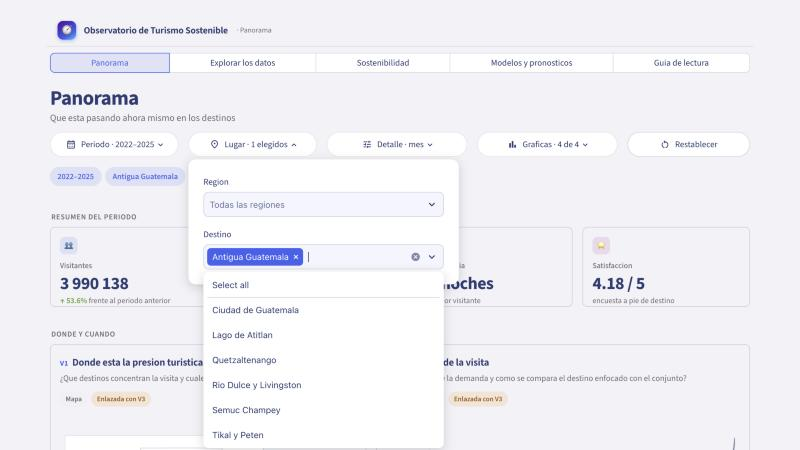{width=70%}

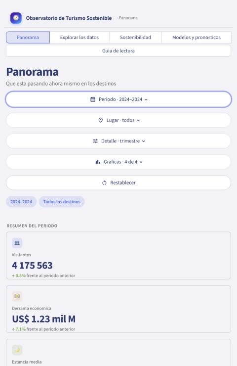{width=45%}

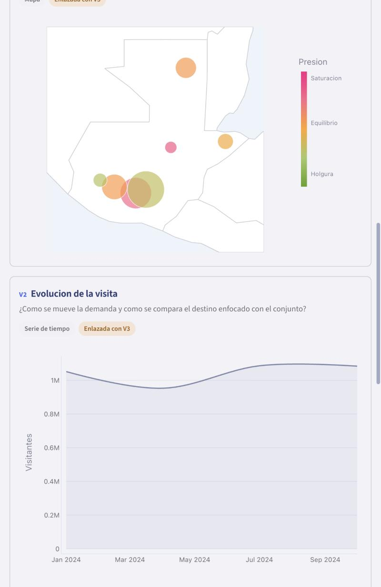{width=45%}

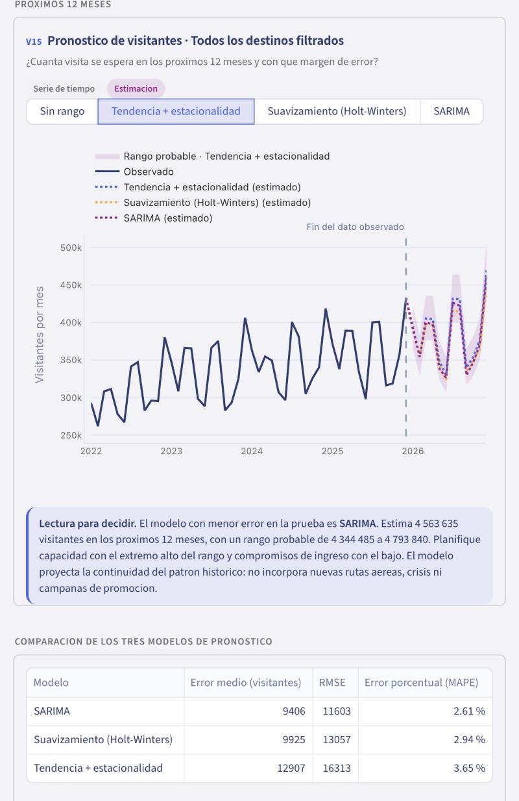{width=45%}

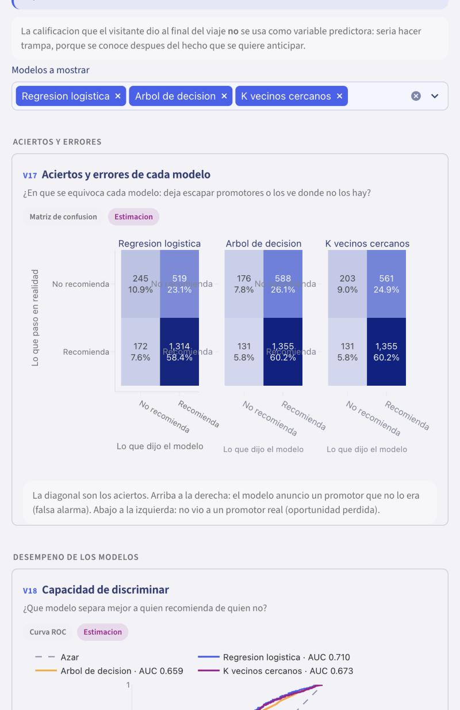{width=45%}

La captura de T1 corresponde a la primera corrida; el valor es el mismo que en la
corrida medida.

## Capturas de Power BI (Lab 12)

Tomadas el 8 de noviembre de 2026 en Power BI Desktop 2.159, PC Windows de Javier.

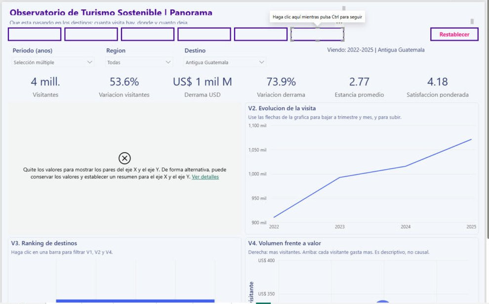{width=70%}

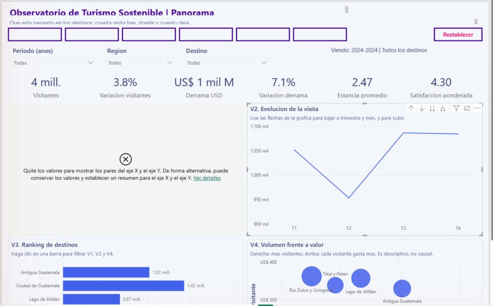{width=45%}

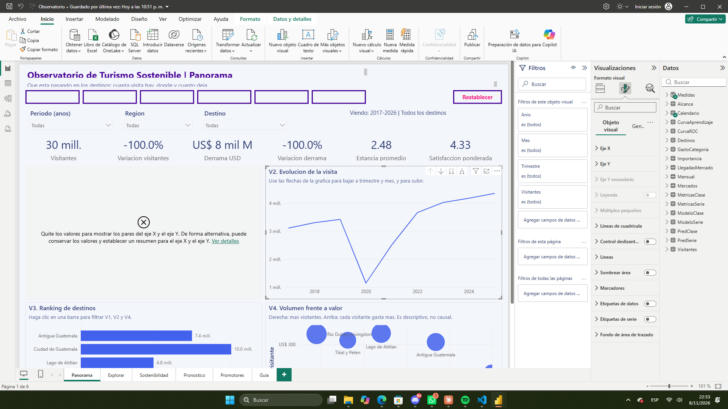{width=45%}

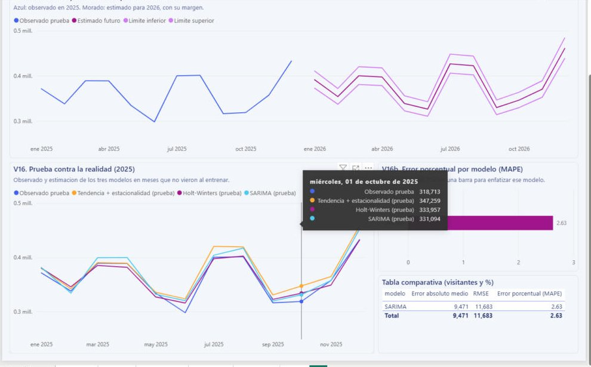{width=45%}

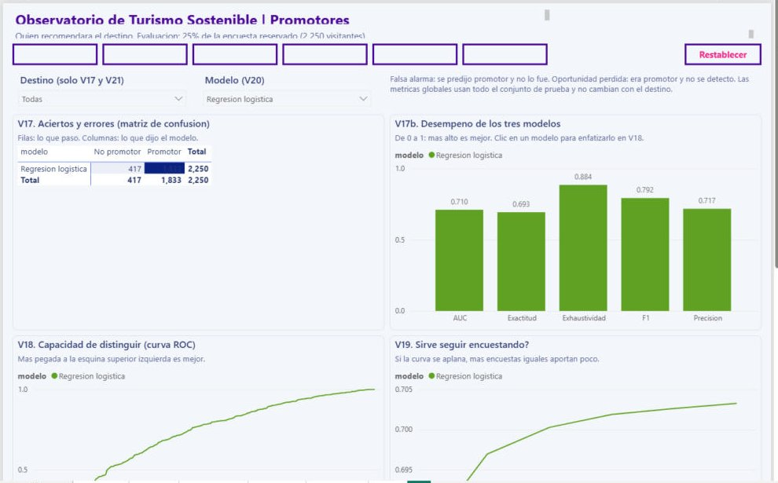{width=45%}

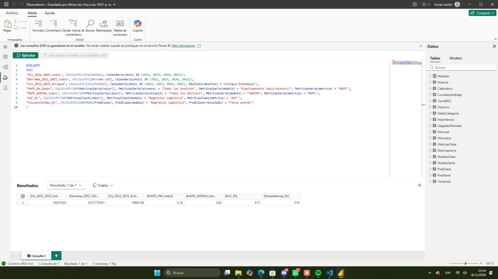{width=80%}

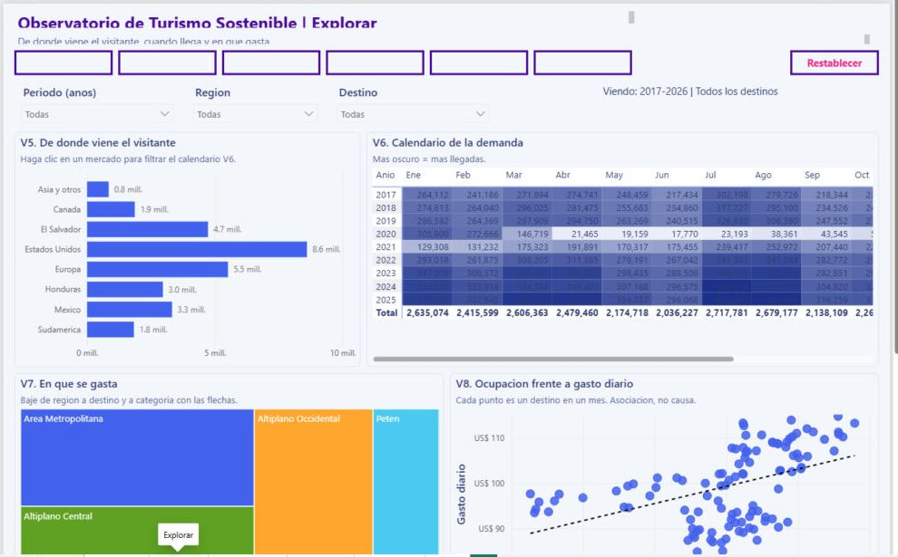{width=45%}

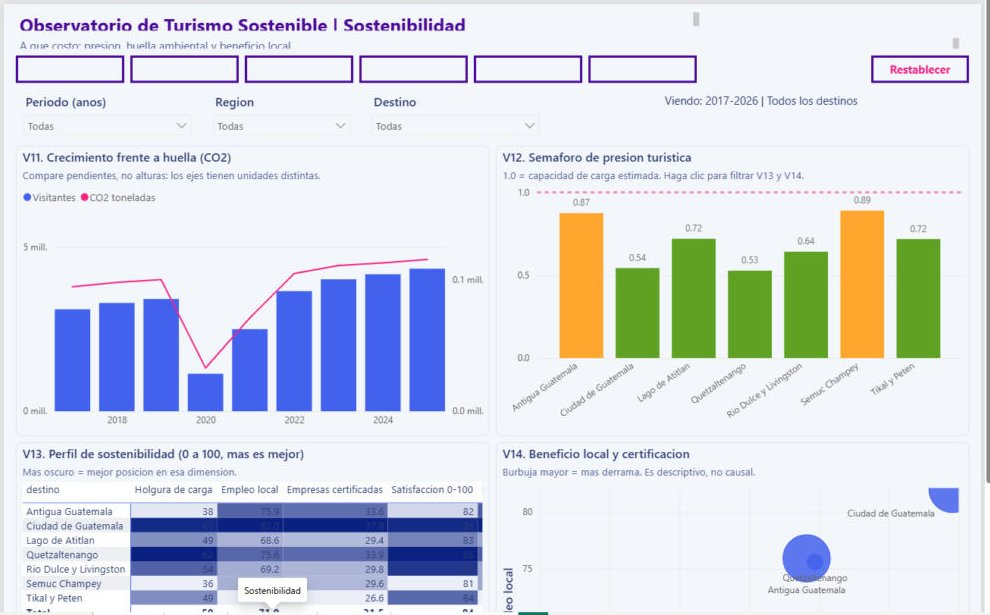{width=45%}

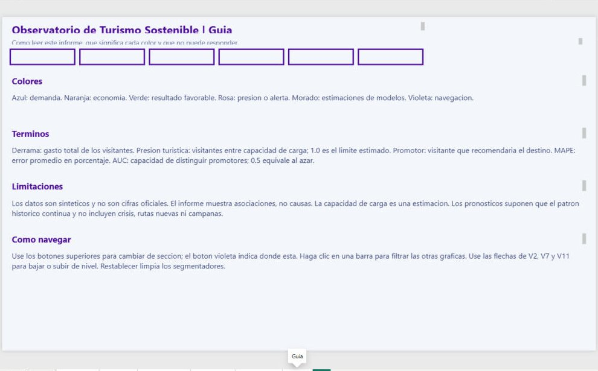{width=45%}

## Problemas observados en la revision en Desktop

El PBIP se genero fuera de Desktop y esta fue su primera apertura. Se observaron tres
problemas que no se alcanzaron a corregir antes de la entrega:

1. **Botones de navegacion sin texto.** Los seis botones superiores aparecen como
   recuadros violeta vacios; la navegacion funciona con las pestanas de pagina, pero el
   usuario no ve el nombre de cada seccion en los botones.
2. **V1 en Panorama no se dibuja.** Desktop muestra el aviso de que los campos de los
   ejes X e Y deben resumirse; el visual queda vacio. V2 a V4 funcionan.
3. **La matriz V17 no separa por clase real.** Muestra solo la clase predicha por modelo,
   por lo que aciertos, falsas alarmas y oportunidades perdidas no se distinguen en el
   visual; las metricas de V17b y la curva ROC si son correctas.

Ademas, Restablecer no limpia los segmentadores de Pronostico y Promotores.

**Repositorio del Laboratorio 10:** <https://github.com/jlope384/Laboratorio-10-Dashboard>
